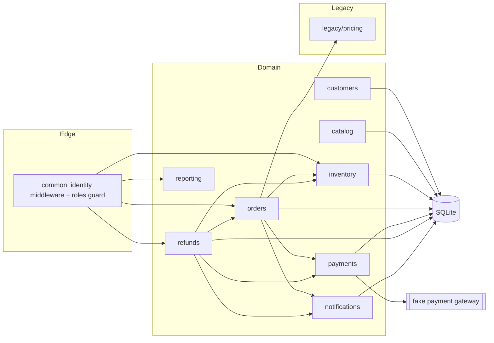

# Architecture notes

## Conventions

- **NestJS 12, ESM.** Relative imports include the `.js` extension (`from './orders.service.js'`) even though the source is `.ts`.
- **Layers.** Controller (HTTP) -> service (rules) -> repository (SQL). Only repositories touch the database, except `reporting`, which queries directly.
- **Money** is integer cents. The legacy pricing module is the exception and is reached only through its adapter.
- **Errors.** Services throw `DomainError` with a code (`NOT_FOUND`, `CONFLICT`, `RULE_VIOLATION`, `FORBIDDEN`, `GATEWAY_TIMEOUT`). One filter maps codes to HTTP statuses.
- **Authorization.** `RolesGuard` checks the role. Ownership checks ("is this your order?") live in services.
- **Transactions.** Multi-step writes go through `DatabaseService.transaction`.
- **Time** comes from the `Clock` provider so tests can control it.
- **Events** are written to an outbox table in the same transaction as the change.
- **Tests.** Vitest. Unit specs sit beside the code; HTTP-level specs are in `test/`.
- **Tools.** `tools/orders-db-mcp` is a separate package with its own pinned dependencies, so the app's dependency list stays small. `scripts/demo-data.sh` adds sample orders through the running API.
