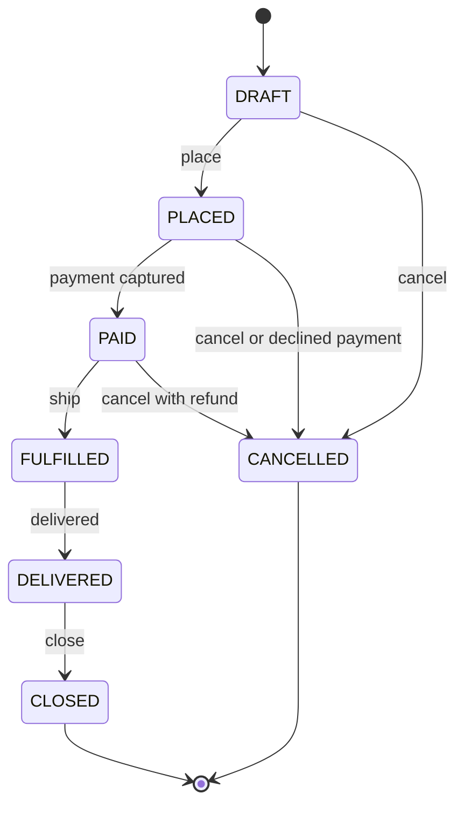
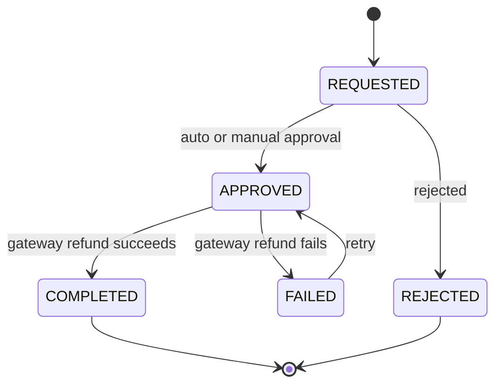

# Product requirements: acme-orders

A fictional outdoor-gear retailer. These are the rules as the product owner wrote them. Treat them as the source of truth for lab tasks. Money is **integer cents** everywhere except inside the legacy pricing module.

## Roles

| Capability | customer | support | admin |
|---|---|---|---|
| Create / read own orders | yes | yes | yes |
| Read any order | no | yes | yes |
| Cancel an order | own, before shipment | any, before shipment | any |
| Request a refund | own orders | any order | any order |
| Approve a refund | no | up to the support limit (REF-6) | any amount |
| Adjust inventory | no | no | yes |
| View reports | no | no | yes |

Identity comes from two request headers, `X-User-Id` and `X-User-Role` (`customer`, `support`, `admin`). There are no passwords or tokens in this course.

## Order lifecycle

## Refund lifecycle

## Orders and inventory

| ID | Rule |
|---|---|
| ORD-1 | An order has 1-50 line items, each with quantity 1-99. |
| ORD-2 | Placing an order reserves stock for every line. If any line cannot be reserved, the order is not placed. |
| ORD-3 | Capturing payment moves the order to `PAID`. Shipping commits reserved stock (reserved and on-hand both decrease). |
| ORD-4 | Cancelling before shipment releases reserved stock. Cancelling a `PAID` order triggers a full refund. |
| ORD-5 | Shipping is free for orders with a subtotal of 7500 cents or more. Otherwise a flat 799 cents. |
| ORD-6 | A promo code gives a percentage off the order subtotal. One code per order. |
| ORD-7 | A declined payment cancels the order and releases its reserved stock. A gateway timeout leaves the order `PLACED` so the payment can be retried. |
| INV-1 | Stock available to sell is `onHand - reserved`. It must never be negative. |

## Payments

| ID | Rule |
|---|---|
| PAY-1 | Payments go through the gateway adapter. The fake gateway is deterministic: charge amounts ending in `13` cents are declined. |
| PAY-2 | A payment records the gateway reference. Gateway calls must be retryable without double-charging. |

## Refunds

| ID | Rule |
|---|---|
| REF-1 | Unopened items may be returned for a refund within 30 days of purchase. |
| REF-2 | Defective items may be refunded within 90 days. |
| REF-3 | Opened, non-defective items are refunded minus a 15% restocking fee. |
| REF-4 | Total refunds on an order can never exceed the amount paid. Partial and multiple refunds are allowed. |
| REF-5 | Shipping is refunded when the whole order is refunded, or when the cause is a defect. |
| REF-6 | Approval: requests up to 5000 cents are auto-approved. Up to 25000 cents need `support`. Anything above needs `admin`. |
| REF-7 | Refunds go to the original payment method via the gateway adapter. If the gateway call fails, the refund is `FAILED` and may be retried. |
| REF-8 | Items bought with a promo code are refunded at the price actually paid. |
| REF-9 | Refunded items marked "returned to stock" are added back to on-hand inventory. |

## Notifications

| ID | Rule |
|---|---|
| NTF-1 | Business events (`order.placed`, `order.paid`, `refund.approved`, `refund.failed`) are written to an outbox table. |
| NTF-2 | A dispatcher drains the outbox and writes a log line per event. (No real email.) |

## Pricing

| ID | Rule |
|---|---|
| PRC-1 | Tax and discount computation is delegated to `legacy/pricing`. It predates the Nest codebase and is called through a thin adapter. |
